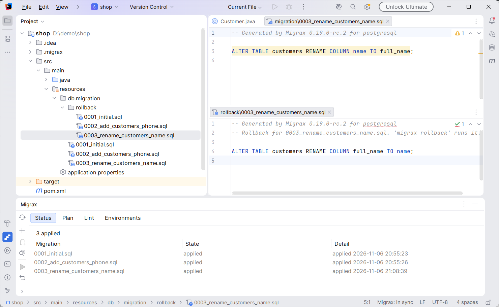
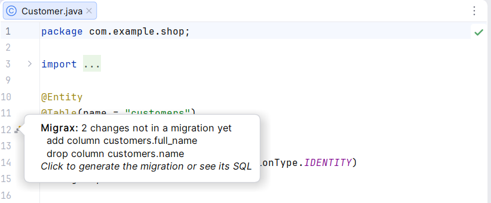
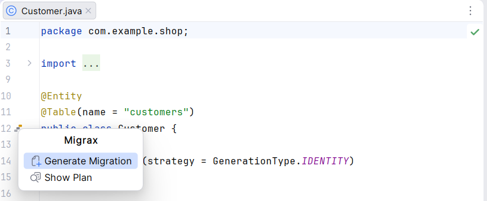
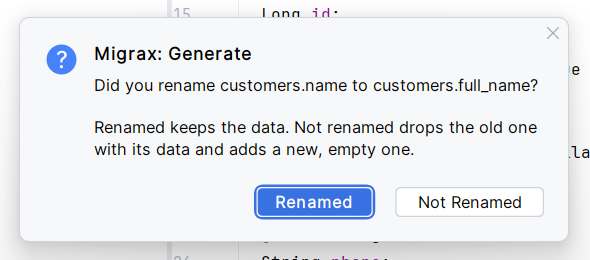
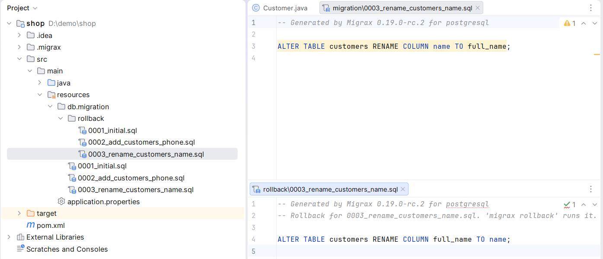
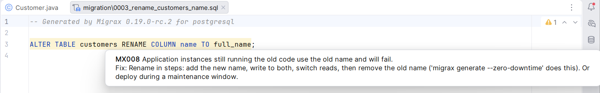
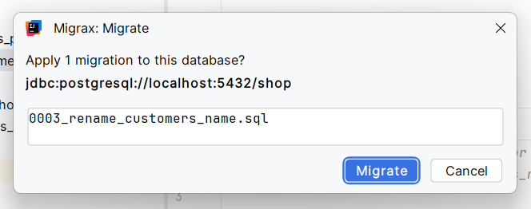
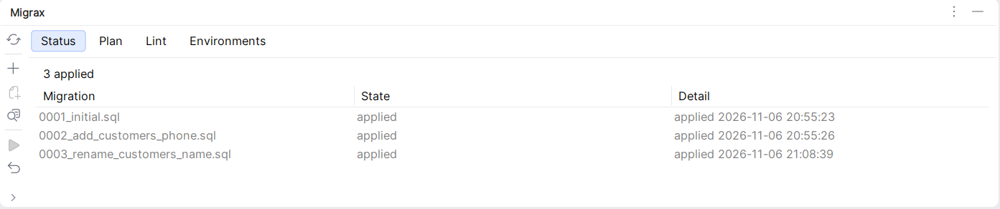

# Generate and apply database migrations without leaving IntelliJ IDEA

You rename a field on a JPA entity. Then you leave the editor to write the SQL, write the
rollback script, check which database you are about to change, and run it. The Migrax plugin
for IntelliJ IDEA keeps all of that in the IDE. This article follows one renamed field from the
edit to the applied migration.

<!-- more -->

!!! info "Tested with"

    Migrax 0.19.0-rc.2, Migrax plugin 0.1.1, IntelliJ IDEA 2026.2.1, Hibernate 6.6.13,
    PostgreSQL 17. Every screenshot and output below comes from a real run.

[](../../assets/blog/intellij/08-overview.png)

*The Migrax plugin after a rename: the generated migration and its rollback script, and the
tool window with every migration applied.*

## Install the plugin

In IntelliJ IDEA open **Settings > Plugins > Marketplace**, search for **Migrax** and click
**Install**. The plugin is free and works in IntelliJ IDEA Community and Ultimate 2024.2 or
newer.

It needs the `migrax` command. It uses the path in **Settings > Tools > Migrax** if you set
one, then `migrax` on your `PATH`, then a copy it downloaded itself. If it finds none, it
offers to download the newest release (about 1 MB), checks it against its SHA-256 and unpacks
it into the IDE's own folder. A Migrax you installed yourself is never changed.

In a project that does not use Migrax yet, choose **Tools > Migrax > Set Up Migrax...**. It
runs `migrax init` in the folder you pick and shows what Migrax detected.

The margin icon in the next section needs Migrax 0.18 or newer, which is a release candidate at
the time of writing. The rest of the plugin works with Migrax 0.17.

## Where we start

This picks up where [Renaming columns and tables without losing
data](renaming-columns-and-tables-without-losing-data.md) started: the same `customers` and
`orders` project, two migrations applied, and two customers in the table:

```text
      email       | id |     name     |      phone
------------------+----+--------------+------------------
 ada@example.com  |  1 | Ada Lovelace | +44 20 7946 0001
 alan@example.com |  2 | Alan Turing  |
```

## Rename the field

In `Customer`, rename `name` to `fullName` and give the column its new name:

```java
  @Column(name = "full_name", nullable = false, length = 100)
  String fullName;
```

A few seconds after the file changes, a Migrax icon appears in the margin next to the
`Customer` class, and the status bar changes from "Migrax: in sync" to "Migrax: 2 changes".
Hover over the icon to see what Migrax found:

[](../../assets/blog/intellij/01-entity-margin-icon.png)

*Two changes: a new column and a dropped one. Migrax does not know yet that they are the same
column.*

Click the icon for **Generate Migration**, or for **Show Plan** to read the SQL first. They do
what `migrax generate` and `migrax plan` do in a terminal.

[](../../assets/blog/intellij/02-margin-icon-menu.png)

## Answer the rename question

Generate Migration asks the question the command line asks:

[](../../assets/blog/intellij/03-rename-question.png)

Answer **Renamed** and the migration keeps the data. Answer **Not Renamed** and Migrax drops
the old column with its data and adds a new, empty one. Before it drops anything it asks
again, and by default it keeps the dropped data in a backup table.

## Review the migration

The new migration and its rollback script open in the editor, next to the earlier ones:

[](../../assets/blog/intellij/04-generated-migration-files.png)

```sql title="db/migration/0003_rename_customers_name.sql"
-- Generated by Migrax 0.19.0-rc.2 for postgresql

ALTER TABLE customers RENAME COLUMN name TO full_name;
```

```sql title="db/migration/rollback/0003_rename_customers_name.sql"
-- Generated by Migrax 0.19.0-rc.2 for postgresql
-- Rollback for 0003_rename_customers_name.sql. 'migrax rollback' runs it.

ALTER TABLE customers RENAME COLUMN full_name TO name;
```

The highlighted line in the migration is a lint finding. Hover over it:

[](../../assets/blog/intellij/06-lint-warning-tooltip.png)

It is the same message `migrax generate` prints in a terminal. A rename moves no data, so the
statement is fast. The warning is about application instances that still run the old code
during a deploy and look for the old column name. The way out it names, `migrax generate
--zero-downtime`, is in the plugin as **Generate for Zero Downtime**.

## Apply the migration

Choose **Tools > Migrax > Migrate...**, or the Migrate button in the tool window. Before it
runs anything, the plugin shows which database it will change and which migrations it will
apply:

[](../../assets/blog/intellij/05-migrate-confirmation.png)

Confirm, and the migration runs in a background task, so the editor stays usable. The status
bar returns to "Migrax: in sync", and the **Migrax** tool window lists every migration and its
state. Click the status bar entry to open it:

[](../../assets/blog/intellij/07-tool-window-status.png)

The rename moved no data. The same two customers are in the table, under the new column name:

```text
 id |      email       |  full_name   |      phone
----+------------------+--------------+------------------
  1 | ada@example.com  | Ada Lovelace | +44 20 7946 0001
  2 | alan@example.com | Alan Turing  |
```

## What else is in the tool window

The tool window has four tabs, and its buttons run the other commands. The [plugin
guide](../../intellij.md) lists every one:

| Where | What it does |
|---|---|
| Status tab | Every migration and its state: applied, pending, failed, changed or missing |
| Plan tab | The SQL of the next migration, with its lint findings |
| Lint tab | Locking and risky SQL in the pending migrations, or in all of them |
| Environments tab | Every configured database: in sync, pending, drift or unreachable |
| Roll Back... | Shows the database and the newest applied migration, then rolls it back |
| Drift | Lists changes made to the database outside the migrations |
| Verify | Applies every migration to a throwaway database and tests each rollback script, leaving your database alone |
| Report | Opens an HTML report of the schema, the migrations, the lint findings and the drift |
| Doctor | Checks Java, the build, the entities and the database connection |

## How it works

The plugin contains no migration logic. Every button runs the `migrax` command in a background
task, asks for `--json` output and draws the answer: the tool window tabs, the margin icon and
the underlines. The IDE, your terminal and your CI call the same command, so they give the same
result.

## What it does not do yet

- With several Migrax projects below one IDE project, the first one found is used.
- Migrate and Roll Back work on the database in the project's settings. Other environments
  show in the Environments tab and are migrated from the command line.
- Migrate and Roll Back cannot be cancelled once they start, because stopping halfway could
  leave a migration half applied.
- The status bar and the margin icons check again about 5 seconds after an entity, migration
  or settings file changes. That check may build the project, and you can turn it off in
  **Settings > Tools > Migrax**.
- Squash and merge are not in the IDE yet: use `migrax squash` and `migrax merge`.
- Only IntelliJ IDEA is supported. Other JetBrains IDEs are not.

## Summary

The Migrax plugin takes an entity edit to an applied migration inside IntelliJ IDEA. The margin
icon shows what changed, **Generate Migration** writes the SQL and the rollback script and asks
about renames, lint marks risky statements in the file, and **Migrate...** names the database
before it runs. It is an early version (0.1.1), free, and open source under the Apache License
2.0.

- [Install it from the JetBrains Marketplace](https://plugins.jetbrains.com/plugin/35665-migrax)
- [Read the plugin guide](../../intellij.md)
- [Browse the source code](https://github.com/fsmutimeer/migrax-intellij)
- [Report a bug or request a feature](https://github.com/fsmutimeer/migrax-intellij/issues)
